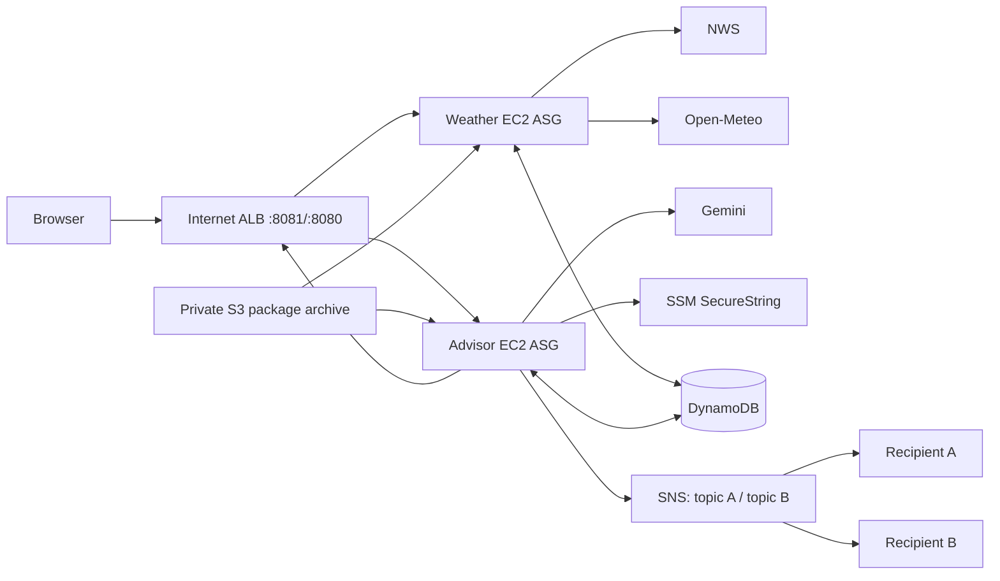

# Weather Advisor — Final Project Design and Evaluation

**Course:** ITMO 444/544 Cloud Computing Technologies
**Student:** Bansari Yadav
**Date:** November 19, 2026

## 1. Executive summary

This implementation uses a two-tier AWS architecture to generate location-specific Morning (06:00–12:00 exclusive) and Night (18:00–24:00 exclusive) weather and clothing guidance. A browser-facing Advisor service calls a Weather service for NWS/Open-Meteo measurements; Gemini or a labeled fallback generates clothing, accessories and road recommendations. A generated report is distinct from the optional, user-consented SNS email transaction. Live tests demonstrated delivery to two separately subscribed recipients. The environment was later scaled down and the load balancer removed to limit costs.

## 2. Architecture and request/data flow

**Trust boundaries:** Internet/ALB, ALB/backend ports, EC2 role/AWS services, third-party forecast and AI providers, and SNS recipient subscriptions. Neither the email address nor the Gemini key is treated as trusted input. The services are independently replaceable and do not depend on a local EC2 filesystem for report persistence.

## 3. Report definitions

| Row | Morning / Night handling |
|---|---|
| Temperature | Period min/max in Fahrenheit, based on NWS when available, supplemented by Open-Meteo |
| Wind speed | Period wind in mph, NWS first and supplementary where required |
| Visibility | Miles derived from Open-Meteo visibility meters; minimum in the period |
| UV index | Highest available hourly UV observation/forecast in period |
| Humidity | Mean of available hourly relative humidity values when needed |
| Rain category | Six-hour period classified from Open-Meteo; incomplete hour coverage yields `Not available` |
| Snow category | Six-hour period classified from Open-Meteo; incomplete coverage yields `Not available` |
| Suggested road conditions | Gemini or clearly labeled fallback interpretation |
| Suggested dressing | Gemini or clearly labeled fallback interpretation |
| Suggested accessories | Gemini or clearly labeled fallback interpretation |

The code requires NWS/Open-Meteo timezone equality. The chosen date is today plus six future dates in the forecast ZIP's local timezone. Missing values are not silently replaced by invented conditions. See `weather-app/report_builder.js`, `weather-app/period_selector.js`, `advisor-app/gemini_report.js`.

## 4. Fifteen documented design decisions

1. **Two independent services** — isolates measurement collection from model-backed interpretation; introduces network failure and ALB cost.
2. **Python/boto3 deployment** — supports procedural, inspectable IAM/ALB/ASG creation and mocked unit tests; requires careful idempotency.
3. **EC2 and Auto Scaling Groups** — supports target-health checks and replaceable instances; has hourly compute cost even while idle.
4. **Single ALB with separate ports/target groups** — provides one internet entry point and health-based routing; raw ports 8080/8081 are less user-friendly than HTTPS routing.
5. **NWS authoritative weather input** — supplies public U.S. forecasts; limited by upstream coverage/API failure.
6. **Open-Meteo supplementary hourly input** — supplies visibility, UV and precipitation intensity; timezones and units must be reconciled.
7. **Local-time date selection** — handles forecast periods from the target ZIP timezone, not the deployment server's timezone.
8. **Explicit six-hour windows** — consistent Morning/Night comparisons; deliberately excludes afternoon/overnight hours.
9. **DynamoDB cache instead of RDS** — avoids a dedicated database instance and supports short-lived key/value records; requires schema/TTL correctness and service permissions.
10. **Gemini advisory only** — AI cannot change numeric weather measurements; model may be unavailable or generate poor suggestions.
11. **Rule-based fallback** — maintains basic advice when Gemini fails, with a visible source label; advice quality may degrade.
12. **Separate consent after report generation** — prevents automatic email when user merely asks for a report; adds a second action.
13. **Recipient-bound expiring token** — shortens exposure window and prevents switching recipient email during send; token links remain sensitive.
14. **One confirmed SNS topic per approved recipient** — prevents cross-recipient broadcasts in the two-person demonstration; does not provide open self-service signup.
15. **Budget-oriented shutdown** — scale ASGs to zero and remove ALB when no demo is needed; public URL is intentionally unavailable between demos.

## 5. Security and privacy threat model

| Threat | Mitigation in inspected files | Residual risk / next improvement |
|---|---|---|
| XSS through model text or inputs | Advisor escapes generated HTML using `escapeHtml` | Add CSP and browser security headers |
| Unauthorized email forwarding | Token/recipient SHA-256 digest, 15-minute expiry, server-side recipient match | Token theft, brute-force and per-visitor abuse remain relevant; add authenticated sessions/CSRF defense |
| Sending one report to unrelated users | `topicForRecipient` allowlist; exactly one confirmed email subscription per topic | Dynamic subscriptions unavailable; maintain a verified mapping for new users |
| Nonconsensual email | Explicit checkbox and POST route | Consent records/withdrawal policy not fully established |
| API key exposure | Advisor reads SSM SecureString via IAM | Rotate key if exposed; verify logs and no plaintext packaging |
| Excess email volume | DynamoDB per-recipient daily reservations, default limit five | Public signup could enable abuse; add per-IP and authenticated limits |
| Overbroad cloud permissions | Separate EC2 IAM roles, prefix-scoped S3 reads and two SNS topic ARNs | Audit all policy statements with live IAM simulation |
| Backend port exposure | Provisioner restricts application access to ALB security group | Confirm inbound SG rules in fresh environment |
| Data in transit | HTTP public ALB was used in demo | **Production requires HTTPS/ACM, secure cookies and HSTS** |
| Third-party prompt sharing | Advisor delegates guidance to Gemini | Verify contract and prompt data minimization before collecting real personal data |

## 6. Reliability, limits and service objectives

**Target SLOs from assignment:** cold report below 20 seconds; cached report below 3 seconds (actual production-wide percentile measurements are not present in uploaded review ZIP). The implementation includes provider timeout handling, cache bypass on DynamoDB failure, labeled Gemini fallback, ALB target health checks, and EC2 replacement via ASGs.

**Demonstrated results:** two real recipient deliveries; two distinct SNS topics and confirmed subscribers; 18/18 Weather JavaScript tests, 30/30 Advisor JavaScript tests and 30/30 selected Python unit tests. The latest Python run deselected 28 integration/chaos cases. Earlier RDS experiments in the repository are **not** proof of this deployment's DynamoDB outage recovery or current SLO compliance.

**Unverified for this submission:** current-version load/soak test percentiles, current DynamoDB outage chaos run, recovery-time measurement on current final-project architecture, and third-party email deliverability outside the two approved recipients. Do not fabricate these figures.

## 7. Cost evaluation

Run `python budget.py` for a **scenario estimate**. The script requires prices to be supplied/confirmed for the selected instance type, ALB hours/LCUs, EC2 EBS/public IPv4, DynamoDB, S3, and SNS. The estimate is not an AWS billing statement. The AWS Cost Explorer/Billing console is the authoritative source for observed spend. A budget below $2 cannot be asserted without current prices, usage and actual billing verification. Main cost controls are minimal demo hours, turning both ASGs to desired zero, deleting the ALB, minimizing storage, and monitoring AWS billing.

## 8. Evidence register

| Evidence | Status | Suggested screenshot / path |
|---|---|---|
| Input form and completed two-period/ten-row report | Live app exercised; screenshot not supplied in review ZIP | `final_evidence/01_form.png`, `02_report.png` |
| User consent and send action | Verified in code | `final_evidence/03_consent.png` |
| SNS topics, exactly one confirmed subscriber each | Live demonstration reported; source ZIP has routing code | `final_evidence/04_sns_topics.png` |
| Gmail recipient received own report | Live observed in earlier run | `final_evidence/05_recipient_a.png` |
| Illinois Tech recipient received own report | Live observed in earlier run | `final_evidence/06_recipient_b.png` |
| Two services healthy behind ALB | Live observed before shutdown | `final_evidence/07_alb_targets.png` |
| Unit tests | 78 local tests passed in three suites | `final_evidence/08_tests.png` |
| Shutdown verification | Both instances terminated; no load balancers; desired 0 | `final_evidence/09_shutdown.png` |
| Actual AWS spending | Not supplied | `final_evidence/10_billing.png` |
| Current chaos/recovery | Not demonstrated in uploaded source/evidence | Add only if actually performed |

Filenames above are **suggestions**, not claims the screenshots already exist.

## 9. Risks, improvements, and reflection

The strongest implementation features are the separation of observed measurements from AI recommendations, location-timezone correctness, user-initiated email consent, explicit single-recipient SNS routing, short report lifetime, and cloud shutdown discipline. The largest risks for a public deployment are HTTP-only access, no public-recipient onboarding workflow, hardcoded demo defaults in application/deployment code, and incomplete current-version chaos/performance evidence. Before production release, replace demo defaults with configuration, enable HTTPS, establish authentication/CSRF protection, add dynamic subscription confirmation with abuse controls, collect metrics and billing, and add end-to-end tests for replacement and outage recovery.

**Reflection:** The project demonstrates the difference between a functional local web app and an operational cloud service: IAM roles, healthy targets, deployment packages, secret distribution, billing and delivery isolation all have to be correct for an apparently simple report to work. The tradeoff is that added controls such as isolated SNS topics and short-lived tokens make a demo secure for known recipients while reducing open signup flexibility. Finally, cost awareness shaped operations: the public demonstration was intentionally taken offline once acceptance testing finished.
