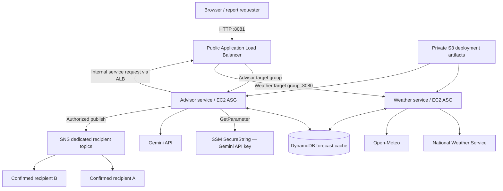
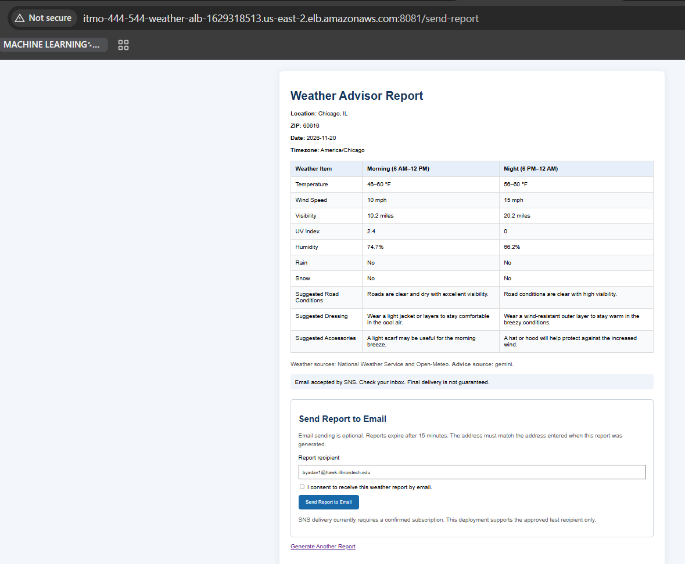
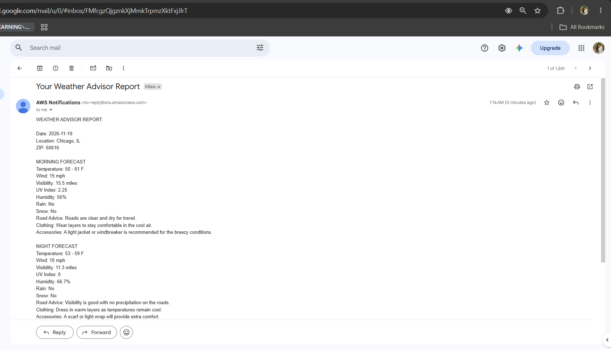
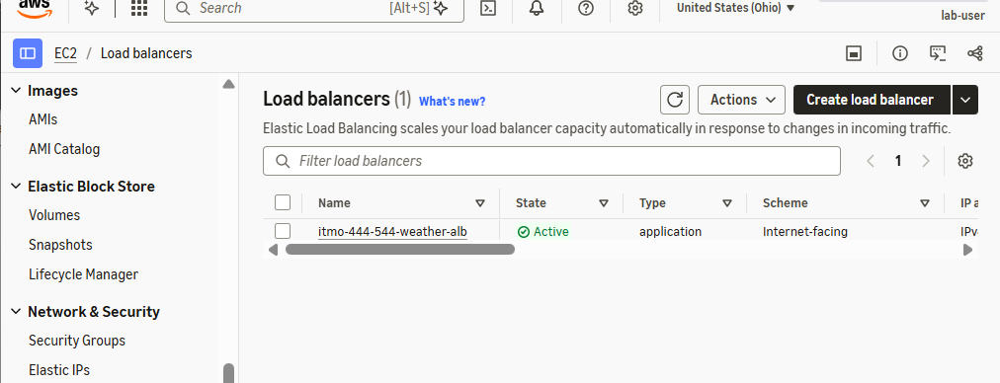
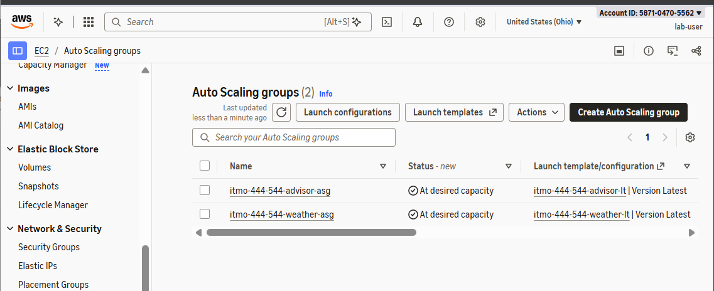
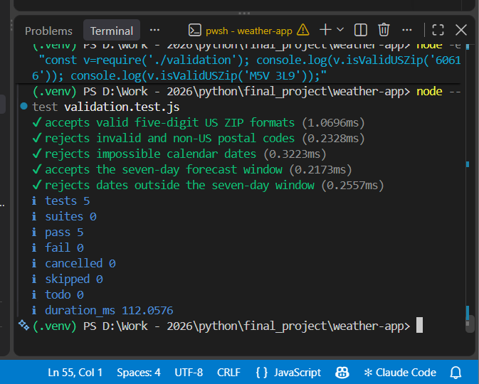

# Weather Advisor — ITMO 444/544 Final Project

**Student:** Bansari Yadav
**Course:** Cloud Computing Technologies, Illinois Institute of Technology
**Project:** Weather Advisor: two-tier, AWS-hosted weather and AI clothing guidance
**Deployment region:** `us-east-2`
**Status:** Live demonstration completed; compute and load balancer shut down after testing (November 19, 2026). Historical ALB URLs are not active.

## Overview

Weather Advisor accepts a five-digit U.S. ZIP code, a forecast date within seven calendar days (today plus six days in the location's timezone), a clothing category (`neutral`, `menswear`, `womenswear`), and an email address. It generates a two-column Morning/Night forecast and clothing/road guidance. **Generating a report does not send an email**: the user must separately check a consent box and click **Send Report to Email** on the report page.

The weather measurements come from the **National Weather Service (NWS)** and supplementary **Open-Meteo** hourly fields. The **Gemini model** contributes interpretive clothing, road, and accessory guidance; it does not invent weather observations. The generated report displays ten rows across Morning/Night: temperature, wind, visibility, UV, humidity, rain, snow, suggested road conditions, dressing, and accessories.

Morning is **06:00–11:59** and Night is **18:00–23:59**, using the forecast location's local timezone. Missing/incomplete measurements are reported as unavailable rather than silently fabricated.

## Architecture



The infrastructure is deployed with **Python/boto3**, not Terraform. Node.js/Express serves both application tiers. AWS EC2 launch templates bootstrap Node and fetch versioned packages from private S3. Auto Scaling Groups manage one independently replaceable tier each. An ALB routes requests by listener to the correct target group. AWS IAM instance roles allow only needed operations; the Advisor role is scoped to its Gemini parameter and approved SNS topics. DynamoDB stores weather cache, short-lived report tokens and request counters, with TTL attributes where applicable.

**Historical demo endpoints** were the project ALB on port 8081 (Advisor) and port 8080 (Weather). They cannot be accessed while the ALB is deleted and the ASGs are scaled to zero.

## User workflow and endpoints

1. Visit the Advisor homepage (`GET /`) and enter ZIP, date, clothing category, and email.
2. `POST /report` validates inputs, retrieves the weather report from the Weather service, calls Gemini or labeled fallback, and saves a recipient-bound report token with a 15-minute expiry.
3. View a complete Morning/Night report. No message is sent yet.
4. Optionally check email consent and submit `POST /send-report` with the same recipient address. The server checks token expiry and recipient digest before SNS publication.
5. SNS delivery is restricted to a **preconfirmed, isolated topic for each of two demonstration recipients**. Unsupported email addresses are rejected. A request acceptance by SNS is not an inbox-delivery guarantee.

Weather API: `GET /weather?zip=60616&date=YYYY-MM-DD`; its root `/` is also used as a health-check endpoint. The Advisor also exposes `/advice` for advice-related requests. Dates must be current to the forecast location, not simply the server's UTC date.


## Project Screenshots

### 1. Weather Advisor Website


### 2. Weather Report and Gemini AI Advice


### 3. Email Consent and Delivery




### 4. AWS Cloud Deployment




### 5. Testing Evidence



### All Screenshots
[View the complete screenshot evidence folder](evidence/screenshot/)
## Implemented security and privacy boundaries

- Input validation for U.S. ZIP format, real calendar dates, forecast range, clothing category and email syntax; request body limited to 4 KB for the HTML Advisor.
- Escaping of dynamic HTML and Gemini output, to reduce injected markup/XSS risk.
- SSM `SecureString` instead of embedded Gemini API key; parameter access through the Advisor EC2 role.
- Separate IAM roles for Weather and Advisor; S3 object read limited to respective deployment package prefixes; SNS publication restricted to two approved topic ARNs.
- A random report token and a SHA-256 token/recipient digest bind the saved report to its intended recipient. Plaintext email is not saved in the report item; reports expire after 15 minutes.
- Dedicated SNS topic per approved recipient, confirmation verification, exactly one subscriber required, fail-closed checks before publication. Recipient-scoped daily send limit via DynamoDB (default five emails per day).
- Application port access restricted to the ALB security group in the provisioner; HTTPS is **not demonstrated** in supplied deployment evidence—public ALB listeners used HTTP for class demo.

**Limitations:** There is no general-purpose signup for arbitrary email recipients, no user authentication, and the public HTTP demo is not suitable for production personal information. Report links/tokens should be protected from disclosure. SNS subscription confirmation and delivery are separate from consent to generate a report. Source settings include hardcoded demo-account/recipient defaults; production deployment should use environment configuration and separate IAM account boundaries.

## Reliability and testing

- Cache-hit reuse through DynamoDB reduces repeat weather-provider work.
- Weather cache read/write failures are logged and can be bypassed while generating a fresh report when upstream providers remain accessible.
- Gemini failure is handled by an identified rule-based fallback, not presented as Gemini output.
- Invalid date/ZIP and missing data return explicit application errors or unavailable values.
- AWS targets were observed healthy, and live reports/email deliveries were demonstrated for both approved recipients before shutdown.

**Executed test evidence (November 2026):** Weather Node suite 18 passed; Advisor Node suite 30 passed; Python selected unit suite 30 passed, 28 deselected by `pytest.ini` because integration/chaos markers are excluded by default. **78 tests executed successfully; 28 were not run in the last suite.** Some inherited integration/chaos tests refer to earlier RDS/uploader-viewer assignments; they are not evidence of the current architecture until rewritten and executed.

### Running tests locally

From the project root:

```powershell
.\.venv\Scripts\python.exe -m pytest -q
Push-Location .\weather-app; npm test; Pop-Location
Push-Location .\advisor-app; npm test; Pop-Location
```

`pytest.ini` excludes tests marked `integration` and `chaos` to prevent accidental cloud activity. **Do not run live/chaos tests while the AWS services are shut down.** The current deployed ALB no longer exists.

## Deployment, rollback and shutdown

The main Python entry points are `create_weather_stack.py` and `delete_weather_stack.py`, backed by `stack/weather_runner.py`, `stack/weather_compute.py`, `stack/weather_iam.py`, `stack/weather_config.py`, `stack/scaling.py`, and ALB/network helpers. `stack/weather_package.py` creates versioned deployment ZIPs, uploaded to private S3.

Deployment requires project AWS permissions, valid `.env` settings, a stored Gemini SSM SecureString, correct S3 artifacts, and the prerequisite DynamoDB tables and SNS subscriptions. Consult the code before deployment. **Do not assume running the create command also creates or confirms all dependent resources.** Scripts inherited from Lab06 (such as `create_database.py` and RDS experiment files) are historical, not part of the current DynamoDB deployment path.

**Verified shutdown, November 19, 2026:** both project instances ended in EC2 `terminated`; ELBv2 returned no load balancers; both Weather and Advisor ASGs showed `Desired = 0`. Private S3 artifacts, DynamoDB items, SNS subscriptions, IAM roles and SSM parameters may remain and should be reviewed individually before final account cleanup. No current public demo link is available until redeployment.

## Repository guide

| Path | Purpose |
|---|---|
| `weather-app/` | Weather service, NWS/Open-Meteo aggregation, date and ZIP validation, DynamoDB cache |
| `advisor-app/` | User form, Gemini guidance, report/consent, SNS email isolation, request limits |
| `stack/weather_*.py` | Current boto3-based Weather Advisor infrastructure/deployment |
| `stack/scaling.py`, `stack/balancer.py`, `stack/network.py` | Auto Scaling, ALB and network provisioning helpers |
| `tests/unit/` | Selected Python mocked unit tests |
| `tests/integration/`, `tests/chaos/` | Historically mixed suites; need current-project replacement and live validation |
| `final_evidence/` | User-collected final-project screenshots if present in original project |
| `evidence/`, `lab03/`, `previous/` | Earlier lab evidence/archive; not current-final proof unless explicitly labeled |
| `previous_lab_docs/` | Backups of Lab05/Lab06 documents |
| `FINAL_PROJECT_REPORT.md` | Final design rationale, security, validation and remaining gaps |
| `SUBMISSION_NOTES.md` | Professor-facing final checklist and evidence map |
| `budget.py` | Illustrative AWS budget calculator—not actual AWS billing |

## Reproduction and integrity

A reviewer should distinguish **verified live behaviors**, **local mock/unit tests**, and **proposed future testing**. Do not include `.env`, credentials, API keys, `.venv`, `node_modules`, archived lab sources, screenshots containing private keys, or outdated `stack_outputs.json` in the final submission ZIP. The professor may need a scheduled, temporary redeployment for a live demonstration; the current URL is not active.
